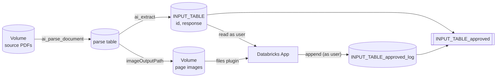

# Intelligent Document Review

Human review of AI document-processing output. A reviewer sees each value the model
produced, the page region it came from, and a confidence badge, then corrects what
is wrong and approves the document.

The form is generated from the data **at runtime**: no field name appears in the
application code, so pointing the app at a different table reshapes the UI with no
code change. (Field names appear only in the test fixtures, which exist to prove
exactly that.) Built with [AppKit](https://developers.databricks.com/docs/appkit/v0/)
(Node/TypeScript + React), plugins `analytics` + `files` + `server`, on-behalf-of-user auth.

## What it can review

Any table with `id STRING` and a `response VARIANT` holding AI function output.
Confidence and evidence are optional, so a function that provides neither still
gives an editable, approvable form.

| Input                          | Values discovered                                         | Confidence                                            | Evidence on the page    |
| ------------------------------ | --------------------------------------------------------- | ----------------------------------------------------- | ----------------------- |
| `ai_extract`                   | one per field, arrays flattened to `line_items[0].amount` | yes                                                   | citation bbox per value |
| `ai_parse_document`            | one per element (`content`)                               | yes                                                   | bbox per element        |
| `ai_classify` 2.x, as returned | one per returned label                                    | 2.1 with `enableConfidenceScores`; else badges hidden | none - no page image    |

## Lineage



| Object                     | Contains                                                                                                                                                                             |
| -------------------------- | ------------------------------------------------------------------------------------------------------------------------------------------------------------------------------------ |
| `INPUT_TABLE`              | your AI function output. **Never written to.**                                                                                                                                       |
| `INPUT_TABLE_approved_log` | append-only: `id`, `approver`, `approved_at`, `approved_response`. One row per approval, so the full history is kept.                                                                |
| `INPUT_TABLE_approved`     | view, one row per input document: `id`, `response`, `latest_approved_response`, `latest_approved_at`, `latest_approver`, `approval_count` (0 until approved). What downstream reads. |

`approved_response` is the **same schema as `response`** with corrected values replaced -
a corrected number stays a number, a boolean stays a boolean, and text that does not parse
as the leaf's own type is refused rather than coerced, as is a number a double cannot hold
exactly. A value the model left `null` has no type to keep, so a reviewer's entry there is
recorded as text; a value that is itself an object or array is shown read-only. Confidence
scores, citations and bounding boxes ride along untouched: the server accepts an edit only
at a value the form itself generated, and the walker never offers `confidence_score`,
`citation_ids` or `bbox` as one. A document with no values at all (a failed AI call) cannot
be approved. So `response` vs `latest_approved_response` is a ready-made model-vs-human evaluation pair.

### Each approval is an independent opinion

The form always starts from `response`, never from an earlier approval, and **approving with
nothing changed is a real answer** - it records that this reviewer read the document and
agrees with the model. Where a previous approval differs, that value is shown beside the box
with the approver's name, as information rather than as the starting point.

Two reviewers of one document therefore produce two comparable opinions rather than one
editing the other's, and the log keeps both. `approval_count` tells you which case you have:
`1` is a clean evaluation pair, and `> 1` means read the log, where the rows are a
disagreement set you can measure agreement on.

What this costs you: the view's `latest_approved_response` is **the most recent reviewer's
whole copy**, not a merge of everyone's corrections. If A corrects a total and B then
approves the document unchanged, the view shows B's copy, with the model's total. That is
the deliberate trade for approvals that cannot overwrite each other and for a read that
never has to be ordered against a concurrent write. **If you want accumulated corrections
rather than independent opinions, read the log** - every approval is there in full, with its
approver and timestamp - or treat `approval_count > 1` as a review task rather than as a
resolved document.

## Identity: user vs service principal

| Hop                         | Runs as                            | Why                                                                 |
| --------------------------- | ---------------------------------- | ------------------------------------------------------------------- |
| Queue + document reads      | **signed-in user** (`asUser(req)`) | Unity Catalog applies the reviewer's own grants                     |
| Approve (`INSERT`)          | **signed-in user**                 | UC attributes the write to the reviewer                             |
| `approver` column           | `X-Forwarded-Email`, server-side   | never accepted from the client, so the audit trail cannot be forged |
| Page images                 | **signed-in user**, files plugin   | `GET /api/files/files/raw?path=…`                                   |
| Warehouse + volume bindings | app **service principal**          | `valueFrom` grants the app; they do not grant the reviewer          |

All SQL lives in `server/routes/review-routes.ts`, not in `config/queries`. Three reasons:
a query file cannot take a table name from the environment; any file there is callable
from the browser with arbitrary parameters, which would make `approver` forgeable; and
query files are typegen'd with `DESCRIBE` run as the **service principal**, which fails
the build for an OBO app whose SP cannot read the table.

## Prerequisites

**Data.** Run the AI functions first - this app only reviews their output:

```sql
-- 1. parse, writing page images the app can show
CREATE OR REPLACE TABLE my.schema.parsed AS
SELECT path AS id,
       ai_parse_document(content, map('imageOutputPath', '/Volumes/my/schema/page_images')) AS response
FROM READ_FILES('/Volumes/my/schema/pdfs', format => 'binaryFile');

-- 2. extract the fields you care about (or ai_classify with version 2.1, used as returned)
CREATE OR REPLACE TABLE my.schema.extracted AS
SELECT id, ai_extract(...) AS response FROM my.schema.parsed;
```

**Grants.** Two different roles:

| Role                     | Needs                                                                                                                                                                                 |
| ------------------------ | ------------------------------------------------------------------------------------------------------------------------------------------------------------------------------------- |
| whoever runs setup, once | `CREATE TABLE` on the schema (this covers views - there is no `CREATE VIEW` privilege), plus `USE CATALOG` and `USE SCHEMA`                                                           |
| every reviewer           | `CAN USE` on the SQL warehouse; `SELECT` on `INPUT_TABLE` and `INPUT_TABLE_approved`; `MODIFY` **and** `SELECT` on `INPUT_TABLE_approved_log`; `READ VOLUME` on the page-image volume |

**App.** Node 22+, Databricks CLI, and the app created with user authorization scopes
`sql` and `files.files` - **scopes are fixed at creation and cannot be added later**.

## Setup

1. Create the app with the two scopes above and bind the resources: SQL warehouse as
   `sql-warehouse`, page-image volume as `files`. Images load from the full `image_uri` the
   output recorded, so they can be in any folder of that volume, but not in another volume.
2. Set `INPUT_TABLE` in `app.yaml` to your `catalog.schema.table`. The two output
   objects are derived from it by name, so there is nothing else to configure.
3. Create them: `npm run setup`, which reads `INPUT_TABLE`,
   `DATABRICKS_WAREHOUSE_ID` and `DATABRICKS_CONFIG_PROFILE` from `.env` (or the
   environment), or run the two statements in
   [`setup/setup.sql`](setup/setup.sql) yourself. It runs as **you**, not as the
   app, so the app never needs `CREATE` on your schema.

```bash
npm install
cp .env.example .env     # DATABRICKS_CONFIG_PROFILE, DATABRICKS_WAREHOUSE_ID,
                         # DATABRICKS_VOLUME_FILES, INPUT_TABLE
npm run dev              # http://localhost:8000
```

Locally, use `npm run dev`: OBO needs a forwarded user token, which `npm run start`
has no proxy to supply.

## Implementation notes

- **Page images are read on behalf of the reviewer**, and only from the bound volume.
  The files plugin defaults to the service principal and resolves any absolute
  `/Volumes/...` path as given, which together would let any user read whatever the SP
  can. `server/server.ts` sets `auth: 'on-behalf-of-user'` and composes the shared
  `withinVolume` policy (`server/files-policy.ts`) with `publicRead()`, so a read runs as
  the reviewer, stays inside the page-image volume, and writes are refused.
- **Edits are re-checked against the server's own copy** (`server/apply-edit.ts`). A path
  from the client has to resolve to a leaf the model itself wrote; new keys, whole-object
  replacement, confidence and citation forgery, and prototype-reaching segments are all
  refused, and the payload is capped. The approver still comes from the request header.
- **CSP, security headers and an Origin check on state-changing requests** live in
  `server/security.ts`, the same baseline as the other AppKit templates.
- **`to_json(...)` arrives already parsed** from AppKit in some cases. Both client and
  server accept a string or an object; asserting either one fails silently.
- **Shape discovery runs in TypeScript** (`shared/walk.ts`, used by client and server), not SQL -
  recursion over arbitrary VARIANT is awkward in SQL, and payloads are small (20 KB for
  a page of parse output). Unit tests pin the three shapes, the volume policy and the
  edit validation.
- **Numbers use `type="text"`**: a native number input coerces DECIMAL to float, turning
  `109303.32` into `109303.3203125`.
- **Bbox colours are fixed hex, not theme tokens** - they sit on an always-white page image.
- **Constraint names are schema-scoped in UC**, so the log's primary key name includes the
  table name; a fixed name collides the second time you run setup in one schema.
- **No dropdown widget**: `ai_extract` stores `enum` as `STRING`, so a closed enum cannot be
  told from a low-cardinality string, and constraining a reviewer to seen values would block
  the correction they came to make.

## Known gaps

- No claim or lock on a document: two reviewers can approve the same one. That is why an
  approval reviews the original rather than a previous approval - neither pass can revert the
  other **in the log**, which holds both in full. The view is the lossy part: it resolves to
  the most recent approval's whole copy, so an unchanged approval after a corrected one does
  hide that correction from anything reading only the view. `approval_count` tells you when
  to look at the log instead. What none of this gives you is a way to _assign_ a document, so
  duplicate review happens by coincidence rather than on purpose.
- The queue is not paginated: it loads the first 1000 documents. For a larger corpus, point
  `INPUT_TABLE` at a view that filters to the slice a reviewer should work through.
- Cross-page citation resolution is implemented but untested - no field in the sample
  corpora cites page 2.
- Numbers beyond about 15 significant digits lose precision in `approved_response` even when
  unedited, because the server rebuilds the document with `JSON.parse`. Extract long
  identifiers as strings.
- Pinned to AppKit 0.98.0, matching the other AppKit templates.
