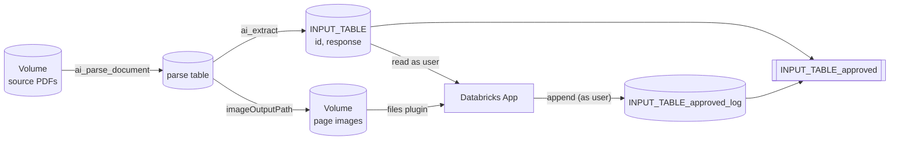

# Intelligent Document Review

Human review of AI document-processing output. A reviewer sees each value the model
produced, the page region it came from, and a confidence badge, then corrects what
is wrong and approves the document.

The form is generated from the data **at runtime**: no field name appears in the
application code, so pointing the app at a different table reshapes the UI with no
code change. (Field names appear only in the test fixtures, which exist to prove
exactly that.) Built with [AppKit](https://developers.databricks.com/docs/appkit/v0/)
(Node/TypeScript + React), plugins `analytics` + `files` + `server`, on-behalf-of-user auth.

## What it can review

Any table with `id STRING` and a `response VARIANT` holding AI function output.
Confidence and evidence are optional, so a function that provides neither still
gives an editable, approvable form.

| Input                                 | Values discovered                                         | Confidence         | Evidence on the page    |
| ------------------------------------- | --------------------------------------------------------- | ------------------ | ----------------------- |
| `ai_extract`                          | one per field, arrays flattened to `line_items[0].amount` | yes                | citation bbox per value |
| `ai_parse_document`                   | one per element (`content`)                               | yes                | bbox per element        |
| `ai_classify` (wrapped into a struct) | one per label                                             | no - badges hidden | page shown, no boxes    |

## Lineage



| Object                     | Contains                                                                                                                                                                             |
| -------------------------- | ------------------------------------------------------------------------------------------------------------------------------------------------------------------------------------ |
| `INPUT_TABLE`              | your AI function output. **Never written to.**                                                                                                                                       |
| `INPUT_TABLE_approved_log` | append-only: `id`, `approver`, `approved_at`, `approved_response`. One row per approval, so the full history is kept.                                                                |
| `INPUT_TABLE_approved`     | view, one row per input document: `id`, `response`, `latest_approved_response`, `latest_approved_at`, `latest_approver`, `approval_count` (0 until approved). What downstream reads. |

`approved_response` is the **same schema as `response`** with corrected values replaced;
confidence scores and citations ride along untouched. So `response` vs
`latest_approved_response` is a ready-made model-vs-human evaluation pair.

## Identity: user vs service principal

| Hop                         | Runs as                            | Why                                                                 |
| --------------------------- | ---------------------------------- | ------------------------------------------------------------------- |
| Queue + document reads      | **signed-in user** (`asUser(req)`) | Unity Catalog applies the reviewer's own grants                     |
| Approve (`INSERT`)          | **signed-in user**                 | UC attributes the write to the reviewer                             |
| `approver` column           | `X-Forwarded-Email`, server-side   | never accepted from the client, so the audit trail cannot be forged |
| Page images                 | **signed-in user**, files plugin   | `GET /api/files/files/raw?path=…`                                   |
| Warehouse + volume bindings | app **service principal**          | `valueFrom` grants the app; they do not grant the reviewer          |

All SQL lives in `server/routes/review-routes.ts`, not in `config/queries`. Three reasons:
a query file cannot take a table name from the environment; any file there is callable
from the browser with arbitrary parameters, which would make `approver` forgeable; and
query files are typegen'd with `DESCRIBE` run as the **service principal**, which fails
the build for an OBO app whose SP cannot read the table.

## Prerequisites

**Data.** Run the AI functions first - this app only reviews their output:

```sql
-- 1. parse, writing page images the app can show
CREATE OR REPLACE TABLE my.schema.parsed AS
SELECT path AS id,
       ai_parse_document(content, map('imageOutputPath', '/Volumes/my/schema/page_images')) AS response
FROM READ_FILES('/Volumes/my/schema/pdfs', format => 'binaryFile');

-- 2. extract the fields you care about (or ai_classify, wrapped into a struct)
CREATE OR REPLACE TABLE my.schema.extracted AS
SELECT id, ai_extract(...) AS response FROM my.schema.parsed;
```

**Grants.** Two different roles:

| Role                     | Needs                                                                                                                                                 |
| ------------------------ | ----------------------------------------------------------------------------------------------------------------------------------------------------- |
| whoever runs setup, once | `CREATE TABLE` on the schema (this covers views - there is no `CREATE VIEW` privilege), plus `USE CATALOG` and `USE SCHEMA`                           |
| every reviewer           | `SELECT` on `INPUT_TABLE` and `INPUT_TABLE_approved`; `MODIFY` **and** `SELECT` on `INPUT_TABLE_approved_log`; `READ VOLUME` on the page-image volume |

**App.** Node 22+, Databricks CLI, and the app created with user authorization scopes
`sql` and `files.files` - **scopes are fixed at creation and cannot be added later**.

## Setup

1. Create the app with the two scopes above and bind the resources: SQL warehouse as
   `sql-warehouse`, page-image volume as `files`.
2. Set `INPUT_TABLE` in `app.yaml` to your `catalog.schema.table`. The two output
   objects are derived from it by name, so there is nothing else to configure.
3. Create them: `INPUT_TABLE=… npm run setup`, or run the two statements in
   [`setup/setup.sql`](setup/setup.sql) yourself.

```bash
npm install
cp .env.example .env     # DATABRICKS_CONFIG_PROFILE, WAREHOUSE_ID, VOLUME_FILES, INPUT_TABLE
npm run dev              # http://localhost:8000
```

Locally, use `npm run dev`: OBO needs a forwarded user token, which `npm run start`
has no proxy to supply.

## Implementation notes

- **`to_json(...)` arrives already parsed** from AppKit in some cases. Both client and
  server accept a string or an object; asserting either one fails silently.
- **Shape discovery runs in TypeScript** (`client/src/pages/review/walk.ts`), not SQL -
  recursion over arbitrary VARIANT is awkward in SQL, and payloads are small (20 KB for
  a page of parse output). 19 unit tests pin the three shapes.
- **Numbers use `type="text"`**: a native number input coerces DECIMAL to float, turning
  `109303.32` into `109303.3203125`.
- **Bbox colours are fixed hex, not theme tokens** - they sit on an always-white page image.
- **Constraint names are schema-scoped in UC**, so the log's primary key name includes the
  table name; a fixed name collides the second time you run setup in one schema.
- **No dropdown widget**: `ai_extract` stores `enum` as `STRING`, so a closed enum cannot be
  told from a low-cardinality string, and constraining a reviewer to seen values would block
  the correction they came to make.

## Known gaps

- No claim or lock on a document: two reviewers can approve the same one, and the view
  resolves by recency (`approval_count` shows how many).
- Cross-page citation resolution is implemented but untested - no field in the sample
  corpora cites page 2.
- Pinned to AppKit 0.84.0, the version `databricks apps init` scaffolds today.
