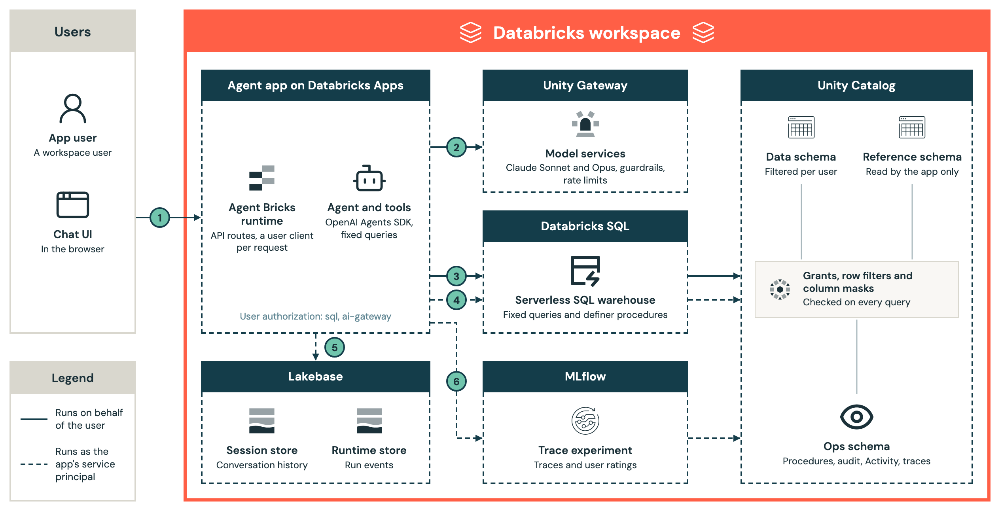

# Full-stack agent example for Databricks

An example agent app on Databricks Apps: a chat UI, an agent server, on-behalf-of-user authorization, writes the user confirms, tracing, evals and bundle deploys.

The example use case is Bank, a fictional bank whose customers read their accounts and confirm a few changes. [docs/customization.md](docs/customization.md) lists the files to change for another use case.

It is maintained by [@mohammadaffaneh](https://github.com/mohammadaffaneh).

## What it does

- Read tools run fixed queries on behalf of the user, so row filters and column masks decide what each user sees. The model has no free-form SQL tool.
- The agent proposes a change, and the user approves it. A definer procedure then runs on behalf of the user, checks the rules, writes the change and an audit row, and replays a repeated idempotency key. Users hold no `MODIFY` on any table.
- The agent calls Unity Gateway model services on behalf of the user, with per-user rate limits, inference tables and guardrails.
- Each run writes Activity rows and an MLflow trace with ratings. Logs, alerts and a dashboard watch the deployed app, and evals test it.

## Architecture

The diagram shows the parts of the app and which identity each call runs as: the user or the app's service principal.



1. The user asks a question in the chat UI. Databricks Apps forwards it to the agent app with the user's token and email. The runtime builds a user client for this request only, and refuses a request without a token.
2. The agent calls a Unity Gateway model service on behalf of the user.
3. On behalf of the user, read tools run fixed queries on the app's warehouse, and an approved change runs a definer procedure. Unity Catalog applies grants, row filters and column masks to every query.
4. As the app's service principal, the runtime reads reference data that users can't read, and appends Activity rows when a run ends.
5. As the app's service principal, the runtime stores history and run events in its Lakebase stores.
6. As the app's service principal, the agent sends traces to MLflow, which keeps them in the ops schema.

[docs/architecture.md](docs/architecture.md) follows a read and a confirmed change step by step. The diagram's source is [docs/images/architecture.html](docs/images/architecture.html).

## Tech stack

- Databricks Apps with user authorization, scopes `sql` and `ai-gateway`
- Agent Bricks runtime and CLI 0.5.0: a `DurableAgentServer` on FastAPI, with managed stores on Lakebase
- OpenAI Agents SDK 0.23.1 on Unity Gateway: Claude Sonnet 5.5 by default, Claude Opus 5.5 on request
- Unity Catalog row filters, column masks and SQL procedures, on a serverless SQL warehouse
- MLflow 3.17 tracing, feedback and GenAI evaluation; Apps telemetry, SQL alerts, an AI/BI dashboard
- Python 3.11 and uv; React 19, assistant-ui, Vite and Tailwind CSS
- Declarative Automation Bundles (Databricks CLI 1.20.0), GitHub Actions with OIDC, pre-commit, pytest, Playwright

Several are in preview: [docs/deployment.md](docs/deployment.md#versions-and-upgrades) lists the pins.

## Deployment prerequisites

- A workspace with Databricks Apps, Agent Bricks and Unity Gateway, and a catalog you can manage.
- Workspace admin rights for the first deploy, which creates service principals and account groups.
- Where the workspace limits app scopes, an admin allows `sql` and `ai-gateway`.
- The Databricks CLI 1.20.0 or later, the Agent Bricks CLI 0.5.0 (`uv tool install databricks-agentbricks==0.5.0`), uv, Node with npm, jq and make.
- The steps only a person can do: [docs/deployment.md](docs/deployment.md#required-setup).

## Local development

Run every command from the project's directory, the one with `databricks.yml`. Local runs use a deployed target's workspace resources, so deploy first.

```bash
export DATABRICKS_CONFIG_PROFILE=<profile>
make install
make dev
```

`make install` installs the frontend packages and Playwright's browsers. `make dev` writes `app/.env`, then starts the agent server on `127.0.0.1:8000` and the Vite dev server, with both of the app's clients running as your profile. `make check` runs pre-commit, and `make test` runs the unit and UI tests ([docs/development.md](docs/development.md)).

## Deploy

Put the target's values in `.databricks/bundle/<target>/variable-overrides.json`, which git ignores ([configuration](docs/deployment.md#configuration)). Then:

```bash
scripts/first_deploy.sh [target]
make deploy TARGET=<target>
```

The first command sets up a new workspace: identities, bundle, schema and data jobs, the agent app and its grants. Every step is safe to rerun. The second command deploys a change. `make destroy TARGET=<target>` removes a deployment other than `staging` and `prod` ([decommission](docs/deployment.md#decommission)). Without a target, each uses the bundle's default, `demo`. The workflows in `.github/` run once the project is in its own repository: they check pull requests and deploy `staging` from `main` and `prod` from a release tag ([CI/CD](docs/deployment.md#cicd)).

## Documentation

- Architecture: [docs/architecture.md](docs/architecture.md) for components, flows and design decisions.
- Security: [docs/security.md](docs/security.md) for identities and data handling, [docs/access.md](docs/access.md) for groups, grants and permissions.
- Agent ops: [docs/runbook.md](docs/runbook.md) for monitoring, alerts and recovery, [docs/evaluation.md](docs/evaluation.md) for evals and guardrails.
- DevOps: [docs/development.md](docs/development.md) for the local loop and tests, [docs/deployment.md](docs/deployment.md) for setup, CI/CD and rollback.
- Backend and frontend: [docs/backend.md](docs/backend.md) for the agent, tools and event stream, [docs/frontend.md](docs/frontend.md) for the chat UI.
- Use case: [docs/customization.md](docs/customization.md), and audit queries in [docs/audit.sql](docs/audit.sql).

## Contributing

See [CONTRIBUTING.md](CONTRIBUTING.md). Coding agents also follow [AGENTS.md](AGENTS.md).
