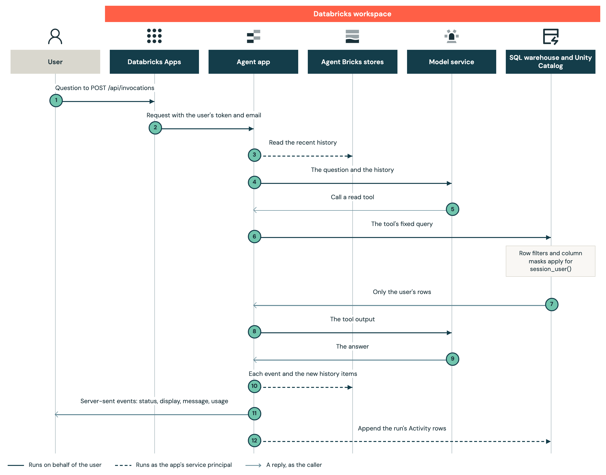
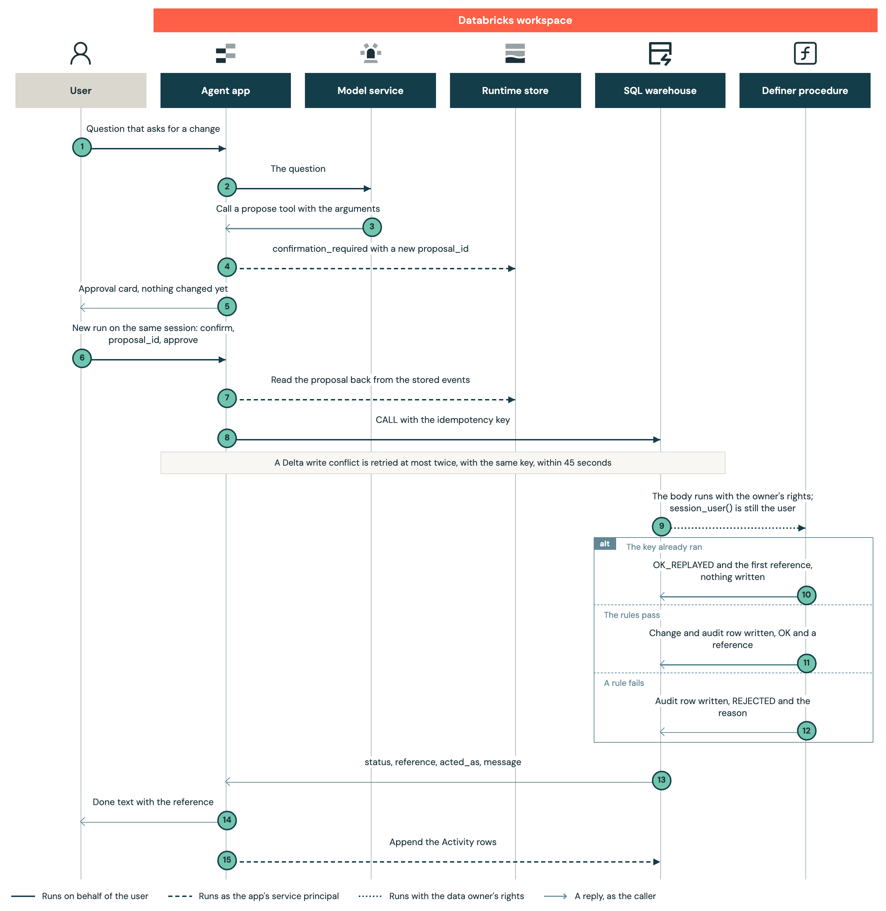

# Architecture

## Overview

One Databricks App serves every user. It is configured with on-behalf-of-user authorization ([why](#on-behalf-of-user-authorization)), so each agent action stays within what Unity Catalog already permits the user. The app's service principal handles only reference data no user may read, the stores, Activity rows, traces and ratings. The [README](../README.md#architecture) shows which calls run as whom, [access.md](access.md) covers grants, and [backend.md](backend.md) covers the agent.

## Components

- **Databricks Apps** signs the user in, forwards each request with the user's token (`X-Forwarded-Access-Token`) and email (`X-Forwarded-Email`), and holds the app warehouse, trace experiment and trace tables as app resources.
- **Agent Bricks runtime**: a `DurableAgentServer` (FastAPI) that runs invocations on behalf of the user and serves `app/static/` (`app/runtime/main.py`, `app/agent.toml`).
- **API routes** (`app/runtime/routers/`): the UI's other `/api` routes, on behalf of the user for their data, as the app's service principal for stores, reference data and ratings.
- **Agent** (`app/agent/`): an OpenAI Agents SDK agent with function tools, run on behalf of the user.
- **Model services** (`resources/model/`): one Unity Gateway model service in `<project>_ops` per model in `app/agent/models.toml`, called on behalf of the user, with rate limits, an inference table and guardrail policies a person attaches.
- **App SQL warehouse** `<project>-app-<target>` runs the app's statements only. Jobs, tests and local runs use the shared `warehouse_id`.
- **Schemas**: `<project>_data` holds the use case's tables (`sql/data/tables.sql`), row-filtered and masked; users hold `SELECT` on them and never `MODIFY`. `<project>_reference` holds tables only the app reads. `<project>_ops` holds the filter and mask functions, definer procedures, the append-only audit and Activity tables, model services, and trace and telemetry tables. `<project>_eval` holds evaluation datasets and prompts.
- **Session store and runtime store**: databases in a Databricks-managed Lakebase project that `agentbricks deploy` provisions, used as the app's service principal. The session store holds each conversation's model history under the runtime's per-user session ID, and the runtime store holds each run's input and events.
- **Trace experiment** `<project>-traces`: one trace per question, confirmation or `/compact`, in Unity Catalog tables in `<project>_ops`, with ratings and a LoggedModel per deployed commit.
- **Apps telemetry** exports log records to `<project>_ops.agent_app_otel_*`.
- **Jobs**, run as the data owner: `schema`, `app_grants`, `trace_retention`, `restore_rehearsal`, `reset_data` (`staging`, `demo`), `sample_data` (`demo`).

### Identities

The example uses three identities: the signed-in user (a user client per request), the app's service principal (one client per process), and the data owner, which owns the tables and procedures and runs the jobs. [security.md](security.md#identities) lists what each calls.

## Read a user's data

In a question that reads the user's rows, every read and model call carries the user's identity.

1. The UI posts the question, the conversation's ID as `session_id`, the model and the effort.
2. The runtime builds the user client and namespaces the session ID by the user.
3. The recent history loads ([Run bounds](backend.md#run-bounds)).
4. The model call runs on behalf of the user, under their rate limits.
5. The model calls a read tool.
6. The tool runs its fixed query (`app/agent/tools/user_data.py`) on behalf of the user.
7. A failed read gives the model no error text ([Reads](backend.md#reads)).
8. The model reads the output.
9. It answers or calls more tools, up to 10 model calls.
10. Events go to the runtime store, and new items go to the session store.
11. The browser streams the stored events. A reopened conversation replays them ([Event replay](frontend.md#event-replay)).
12. When the run ends, also after a failure, its tool events go to `<project>_ops.assistant_activity`.

## Confirm a change

A change the model proposes runs only after the user approves it, and runs at most once.

1. The user asks for a change.
2. The model call runs on behalf of the user.
3. The model calls the action's propose tool (`app/agent/tools/actions.py`), which checks the arguments.
4. The tool emits `confirmation_required`, the only copy of the proposal.
5. The UI shows the approval card.
6. Approve or Cancel sends a `confirm` input as a new run. The model takes no part, so it can't approve its own proposal.
7. `confirm` (`app/agent/approvals.py`) reads the proposal back.
8. On approve, the app calls the procedure on behalf of the user, with a key from the session and the proposal.
9. The definer body runs with the owner's rights.
10. An `OK` audit row with the same key and actor means a replay.
11. Otherwise it checks the rules and writes the change and an audit row.
12. A failed rule writes only a `REJECTED` audit row.
13. A permission error becomes `DENIED`.
14. The user sees the done text or why nothing changed ([Propose and confirm](backend.md#propose-and-confirm)).
15. Activity rows are appended as the app's service principal.

## Invariants

Breaking one needs a design change.

- **A run needs a user token**, and nothing falls back to the app's service principal (`app/runtime/adapter.py`).
- **No user client outlives its request** (`app/runtime/auth.py`).
- **The actor comes from the sign-in:** `X-Forwarded-Email` in API routes, `current_user.me()` in the agent (`app/agent/context.py`).
- **The model has no free-form SQL tool**, and `app/agent/mcps.py` builds no MCP server.
- **No user holds `MODIFY`.** Writes go only through definer procedures.
- **Every write needs a confirmation and runs at most once.** Only a `confirm` input, which the model can't send, runs a write; a key that succeeded replays.
- **No turn that proposed or decided a change is replaced.**
- **Activity rows come only from `RequestContext.tool_event`,** appended as the app's service principal with one plain `INSERT`, never `MERGE` ([Audit and Activity](security.md#audit-and-activity)).

## Design decisions

### On-behalf-of-user authorization

On-behalf-of-user authorization lets an app act on behalf of its user ([Databricks Apps auth](https://docs.databricks.com/aws/en/dev-tools/databricks-apps/auth)). The app requests the `sql` and `ai-gateway` scopes and fails closed without a token ([on-behalf-of-user guidance](https://www.databricks.com/blog/now-ga-building-permission-aware-databricks-apps-behalf-user-authorization)), so Unity Catalog and Unity Gateway decide what each user can read, change and call, and audit records and traces name the user.

### Reads use fixed queries

Users hold `EXECUTE` on the write procedures, so a model writing its own SQL could call one without a card, for example after a prompt injection in a row it read. The managed SQL MCP server (`system.ai.dbsql`) runs SQL with the caller's permissions ([managed MCP servers](https://docs.databricks.com/aws/en/generative-ai/mcp/managed-mcp)), `EXECUTE` included. The app requests `sql` to run `CALL`; an app that only reads should request the read-only `sql:restricted-query`.

### Writes go through definer procedures

A `SQL SECURITY DEFINER` procedure runs its body with its owner's rights, and `session_user()` still returns the caller ([CREATE PROCEDURE](https://docs.databricks.com/aws/en/sql/language-manual/sql-ref-syntax-ddl-create-procedure)). The caller needs only `EXECUTE`. Each procedure checks the rules for the real user, and no user needs `MODIFY`.

### Confirmation starts a second run

The Agent Bricks runtime rejects pause and resume for user-authorized runs (`MCP_USER_AUTH_HITL_UNSUPPORTED`). Reading the proposal back from stored events keeps the app stateless across instances and restarts.

### An interrupted run fails

The runtime can't recover a run that needs the user's credential ([agent server](https://docs.databricks.com/aws/en/agents/deploy/agent-server)). The `recover` handler fails it with `MCP_USER_AUTH_RECOVERY_UNSUPPORTED`, and the user sends the message again.

### Stop is an app route

The runtime has no cancel route. The app's Stop ([Conversations](backend.md#conversations)) finds the run in process memory, so the app deploys one instance (`--instances 1` in `scripts/deploy_agent.sh`): `X-Routing-Key` routing is best effort ([horizontal scaling](https://docs.databricks.com/aws/en/dev-tools/databricks-apps/horizontal-scaling)).

### Records stay in their system of record

Each action changes the record with one governed write, on behalf of the user, with an idempotency key. This example's Delta tables and SQL procedures fit low-rate self-service changes that take seconds. A real system of record stays behind its own API, which checks the rules. Lakebase with Postgres row-level security fits when Delta's latency or write rate rules it out; the team that adopts it then owns that enforcement.

### Lakebase holds run state and Delta holds records

Each streamed event is one write, and a Delta insert through the warehouse takes a second or more, so run state lives in the platform-managed Agent Bricks stores on Lakebase ([managed sessions](https://docs.databricks.com/aws/en/agents/agent-memory/managed-sessions)). Records stay in Delta for Unity Catalog's row filters and masks: a Lakebase synced table can't carry row-level security ([synced tables](https://docs.databricks.com/aws/en/oltp/projects/sync-tables)).

### The agent calls its own model services on behalf of the user

The agent calls its own Unity Gateway model services instead of `system.ai` models, so each carries the app's rate limits, an inference table and an `EXECUTE` grant to the app users group ([model services](https://docs.databricks.com/aws/en/ai-gateway/model-services)).

### Traces go to Unity Catalog tables

Apps compute can't reach the storage host the default MLflow store uploads spans to, so traces go to Unity Catalog tables in `<project>_ops` ([traces in Unity Catalog](https://docs.databricks.com/aws/en/mlflow3/genai/tracing/trace-unity-catalog)). `mlflow.trace.session` joins a conversation's traces, because Unity Catalog traces have no span links ([spans](https://mlflow.org/docs/latest/genai/concepts/span/)).

### Each deployed commit gets a LoggedModel

`scripts/deploy_agent.sh` links every trace to the deployed commit's LoggedModel ([Versions](runbook.md#versions)).

### Activity has its own table

`system.access.audit` is for administrators. Users read their own Activity, so the app writes it to its own append-only, row-filtered table.

### A script adds the deploy steps the Agent Bricks CLI lacks

`agentbricks deploy` can't set a warehouse resource, a usage policy or telemetry export, and the bundle can't declare an app `agentbricks` owns, so `scripts/deploy_agent.sh` sets them ([Agent app](deployment.md#agent-app)).

### Two private APIs are pinned

`app/runtime/stores.py` reads a session's events through the server's private `_runtime`, because the runtime has no public read. `GatewayCompletions` subclasses `AsyncDatabricksCompletions`, which `databricks_openai` doesn't export. Both packages are pinned with `==` in `app/pyproject.toml`, and the unit tests run the real server and gateway client, so a breaking upgrade fails there. The conversation routes check ownership themselves: a session's `actor_id` grants nothing.

## Code map

- `databricks.yml`, `use_case.yml`: the bundle's targets and variables, with `project` and `display_name` in `use_case.yml`.
- `resources/`: bundle resources by concern (`data/`, `app/`, `model/`, `observability/`, `evals/`); `sql/`: the jobs' notebooks, by the same concerns.
- `app/agent.toml`, `app/app.yaml`: the runtime's configuration, and the app's start command and env.
- `app/runtime/`, `app/agent/`: the server and the agent ([Layout](backend.md#layout)), with unit tests in `app/tests/`.
- `frontend/`: the UI source and Playwright tests ([Stack and layout](frontend.md#stack-and-layout)), built into the committed `app/static/` ([Build](frontend.md#build)).
- `evals/`: evals against the deployed app, and their tests.
- `scripts/`: identity setup, deploys, teardown, test user tokens, conversation cleanup.
- `tests/`: workspace suites that check what each identity reaches, with `tests/fixtures/`.
- `demo/`: the demo target, its users and rows.
- `Makefile`: `install`, `dev`, `check`, `test`, `build`, `deploy`, `reset`, `destroy`.

## Known limits

- **The Delta tables are a sample record store.** Delta has no row locks or enforced unique keys.
- **Trace tables are unfiltered** ([who reads them](security.md#trace-telemetry-and-inference-data)).
- **Summaries can misstate.** `/compact` replaces older history with a model's summary.
- **Thinking summaries aren't bound by the prompt.** They can name tools or work out figures; the evals cover neither them nor the Opus model.
- **The model and effort last only until the tab reloads.**
- **A stream cut more than 3 times fails** (`frontend/src/lib/sse.ts`).
- **Preview components** are pinned as [deployment.md](deployment.md#versions-and-upgrades) lists. [frontend.md](frontend.md) lists the UI limits.
